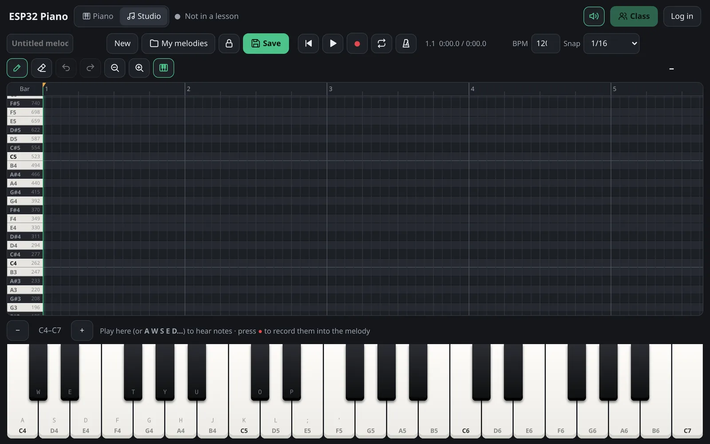
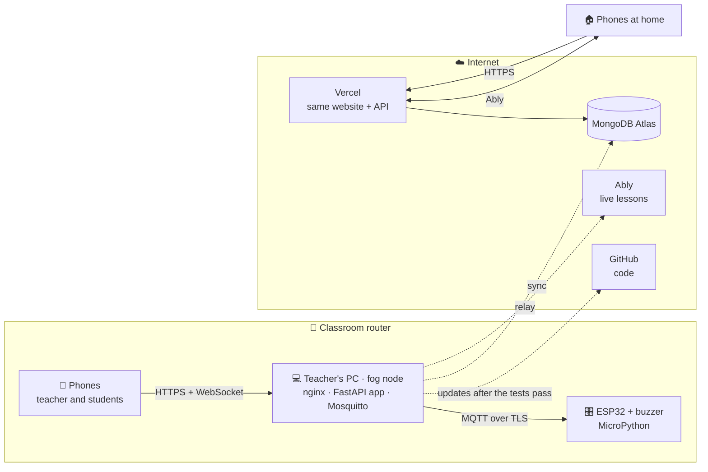
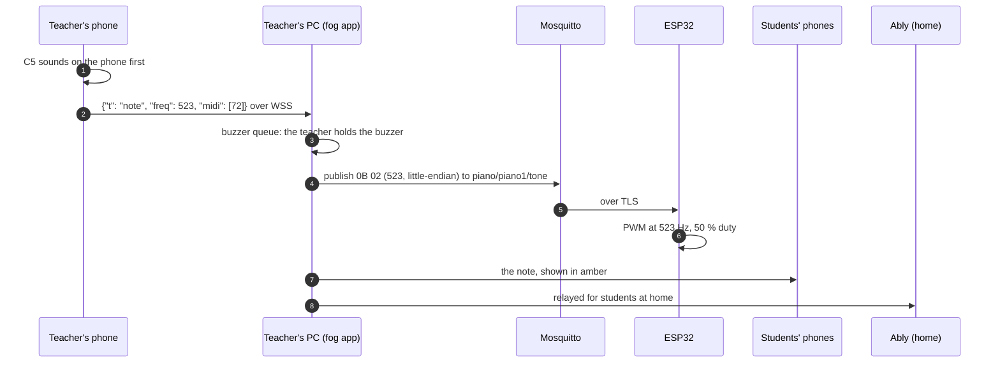
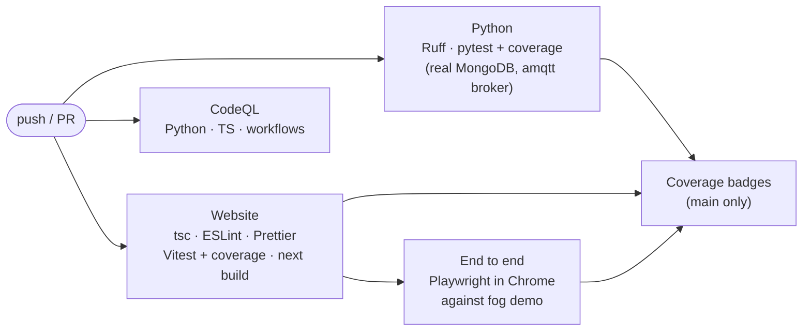

<div align="center">

# 🎹 ESP32 Piano

**Piano lessons where the teacher's notes ring out on an ESP32 buzzer and light up on every student's
phone**, in the classroom or at home.

[](https://github.com/Pablo-Caballero-Maria/piano/actions/workflows/ci.yml)
[](https://github.com/Pablo-Caballero-Maria/piano/actions/workflows/codeql.yml)
[](https://github.com/Pablo-Caballero-Maria/piano/actions/workflows/ci.yml)
[](https://github.com/Pablo-Caballero-Maria/piano/actions/workflows/ci.yml)
[](https://github.com/Pablo-Caballero-Maria/piano/releases)
[](LICENSE)
[](https://piano-web-virid.vercel.app)


[**Open the website**](https://piano-web-virid.vercel.app) ·
[Wiki](https://github.com/Pablo-Caballero-Maria/piano/wiki) ·
[Project report (Spanish)](docs/memoria/memoria.pdf) ·
[Changelog](CHANGELOG.md) ·
[Write-up on my portfolio](https://pablo-portfolio-woad.vercel.app/projects/piano)



</div>

A web piano for piano lessons. The teacher and every student use their phone (or PC). The teacher
plays — on the piano or in the **Studio**, a piano roll like FL Studio's — and the notes sound on a
buzzer driven by an ESP32 in the classroom while every student sees them live on their own phone.
Everyone can also practise alone (piano and studio), save melodies privately or share them publicly,
and follow lessons from home over the internet.

| 🧪 Automated tests | 📡 Internet needed in class | 🔐 Encryption at rest | 🔄 Updates |
| :---: | :---: | :---: | :---: |
| 197 (18 run on the board) | none | AES-256-GCM | from GitHub, after the tests pass |

> [!NOTE]
> The project report (in Spanish) is [docs/memoria/memoria.pdf](docs/memoria/memoria.pdf). It works end
> to end on real hardware: on 18 November 2026 two phones held a lesson with the buzzer playing, on a
> phone's hotspot as the classroom router.

## Contents

- [Architecture](#architecture)
- [A class](#a-class)
- [Setting up the teacher's PC](#setting-up-the-teachers-pc)
- [The board](#the-board)
- [Online: Vercel and Ably](#online-vercel-and-ably)
- [Development](#development)
- [Quality and continuous integration](#quality-and-continuous-integration)
- [Security](#security)
- [Protocols](#protocols-details-in-each-modules-docstring)
- [Troubleshooting](#troubleshooting)
- [Documentation](#documentation)
- [Contributing](#contributing)
- [Citing](#citing)
- [License](#license)
- [Project context](#project-context-for-the-next-claude-code-session-read-this-first)

## Architecture



- **The teacher's PC** is the *fog node*: it serves the website to the phones in the classroom
  (nginx, HTTPS for `piano-esp32.duckdns.org`), runs the live class, and drives the board over
  MQTT. It keeps **no database**: accounts and melodies live on the board. Whenever it has
  internet it updates itself and the board from GitHub (after testing the new version), syncs the
  board with MongoDB Atlas, and relays the lesson to Ably for students at home.
- **The board** (ESP32, MicroPython) joins the classroom WiFi, plays the buzzer and stores the
  class's accounts and melodies — encrypted: it can't read them.
- **Vercel** serves the same website for everyone, with the same API on Atlas, plus live lessons
  over the internet with Ably.
- Everything is **encrypted in transit** (HTTPS, WSS, MQTT over TLS) and **at rest** (every stored
  record is sealed with AES-256-GCM using a system key that only the teacher PCs and Vercel hold).

<details>
<summary><b>The journey of one note</b></summary>



The buzzer has one voice, so a chord is sent as its **resultant frequency**: since
sin a + sin b = 2·cos((a−b)/2)·sin((a+b)/2), two notes together sound like a wave at their mean
frequency whose volume beats at their difference, and the buzzer plays that mean.

</details>

### Repository layout

| Folder | What it holds |
| --- | --- |
| `pianocore/` | shared by the PC and Vercel: crypto, models, auth, repositories (board / Atlas), the rules (`service.py`), board⇄Atlas sync, the REST API, Ably helpers |
| `fog/` | the teacher's PC: `app.py` (FastAPI), `classroom.py` (live class), `buzzer_queue.py`, `board.py` (MQTT link), `sync_service.py`, `updater.py` (GitHub), `internet.py` (DuckDNS), `ably_bridge.py`, `simboard.py` (simulated board), `settings.py` (`.env`); `python -m fog` |
| `esp32/` | the board's firmware: `main.py` (boot, rollback, update mode), `app.py`, `mqtt.py` (own MQTT client), `kv.py` (encrypted-blob store), `tone.py`, `config.py`, `updater.py`, `ota.py` |
| `api/` | the Vercel function (`index.py`): the API on Atlas, Ably tokens, live lessons |
| `web/` | the website: Next.js + TypeScript, built as a static export (`web/out`) that Vercel and the PC serve; `src/services/link` (class link: WebSocket or Ably), `src/state` (the class), `src/studio` (piano roll engine), `src/components` (React). See [web/README.md](web/README.md) |
| `install.sh` | sets up a teacher's PC and its board from a fresh clone (asks what it needs) |
| `deploy/` | nginx, Mosquitto, certbot (DuckDNS DNS challenge) and systemd setup: `sudo deploy/setup.sh` |
| `tools/` | `board.py` (install the board over USB), `configure.py` (`.env` questions), `fake_board.py` (pretend board), `sim/` (lets the board's MicroPython code run on CPython) |
| `tests/` | `core/`, `fog/`, `board/` (also run **on** the board), integration (real broker); the website's tests are in `web/tests` (Vitest) and `web/e2e` (Playwright) |
| `buzzer.py` | the very first demo (scales and tunes, no network), run with mpremote |
| `docs/memoria/` | the project report, `memoria.pdf` (in Spanish), and its diagrams (`uv run python docs/memoria/diagramas.py` redraws them) |

## A class

1. Everyone joins the classroom WiFi (the router) and opens the classroom's address
   (**https://piano-esp32.duckdns.org** for the first classroom).
2. **Create an account** (Log in → Create account), choosing **student** or **teacher**. The
   password never leaves the phone (it sends a PBKDF2 key). An account made on any classroom PC or
   online works everywhere once the PC has synced.
3. The class is everyone connected to the teacher's PC. The **Class** button opens the class panel.
4. The teacher presses **Start the lesson** (in the mode they're in: piano or studio):
   - piano: every student sees the teacher's notes on their keyboard (amber marks) and in the bar;
   - studio: the students' studio shows the teacher's piano roll, read-only and in step with the
     teacher's playback; their own melody comes back when the lesson ends ("Back to my melody");
   - the buzzer plays the teacher; the teacher can **Give buzzer** to a student and take it back.
5. The teacher's panel lists everyone: their mode, what they're playing, what they're editing
   (and students following from home, marked "from home").
6. Without a lesson, anyone can **Ask for the buzzer**: they queue, first come first served, and
   the first one plays. Teachers administer the queue (move up, remove, **Next**).
7. Melodies (Studio → Save) are **private** (lock) or **public** (globe): everyone can see and edit
   a public melody; only its owner deletes it or makes it private. "Melodies" has *Mine* and
   *Public* tabs; the list says who made each and who edited it last.

Online (Vercel, with internet): the same website and accounts; the Class panel lists **live
lessons** (online ones, and classroom lessons relayed by their PC) to join; teachers can give a
lesson from home. There's no buzzer online.

The piano keyboard: tap/click, slide for a glissando, or computer keys `A W S E D F T G Y H U J K
O L P` (`Z`/`X` octave). The Studio: draw/erase notes, snap, BPM, zoom, undo/redo, loop,
metronome, record from the piano; overlapping notes play their **resultant frequency** (the mean:
sin a + sin b = 2·cos((a−b)/2)·sin((a+b)/2)), because the buzzer has one voice. Details are in the
code comments of `web/src/studio/engine.ts` and `web/src/lib/notes.ts`.

## Setting up the teacher's PC

On the PC (Linux with systemd: Arch, Debian/Ubuntu, Fedora), as yourself — not with sudo:

```sh
git clone https://github.com/Pablo-Caballero-Maria/piano.git && cd piano
./install.sh            # everything; safe to run again
./install.sh board      # later, when you plug the board in by USB
./install.sh config     # change an answer (.env), then ./install.sh again
sudo deploy/uninstall.sh # undo it on this PC: services, certificate, configuration (keeps
                         # the packages, the repository and .env, the DuckDNS name, the board)
```

`install.sh` installs what's missing (nginx, mosquitto, certbot, curl, uv — asking first), the
app's Python, builds the website (with the Node.js that uv installs: the `web` group of
`pyproject.toml`, so every PC builds it with the same version), asks the questions that fill in
`.env` (`tools/configure.py`), runs
`sudo deploy/setup.sh`, offers to make the PC join the classroom WiFi at boot (once the PC has
joined it as usual: it keeps that connection, whose password works, and warns if `.env`'s differs)
and to keep running with the lid closed while plugged in, installs the board if it's plugged in, and checks it all
(`uv run python -m fog check`). Everything after that is automatic (next section).

`.env` (never committed: the repository is public; mode 600). **PIANO_DATA_KEY**, the system key:
the same on every teacher PC and on Vercel, or they can't read each other's data (keep it: data
sealed with a lost key is gone). The installer asks for it, or creates a new system when left
empty. Also this classroom's DuckDNS name and token, the classroom WiFi (for the board and the
PC), MONGODB_URI and ABLY_API_KEY (optional: without them the class works offline only).
`setup.sh` generates the MQTT passwords. `PIANO_PUBLIC_URL` defaults to
`https://<DUCKDNS_DOMAIN>.duckdns.org`.

What `deploy/setup.sh` does: points the DuckDNS name at the PC's **classroom** address
(phones reach it on the router); gets a Let's Encrypt certificate with a DNS challenge through
DuckDNS (works on a private address) and enables its renewal (the distribution's certbot timer,
or its own); configures Mosquitto (port 1883 on localhost for the app, 8883 with TLS for the
boards, a user per board that may only use its own topics) and nginx (HTTPS on 443 in front of
the app, which serves everything: the repository is in a home folder nginx can't read); installs
the app as the `piano-fog` service (restarts on failure and after updates). Logs:
`journalctl -u piano-fog -f`.

### Another teacher

The same steps, on their own PC. What they need first (the installer asks for it):

- **their own DuckDNS name** (duckdns.org: sign in, add a name, copy the token): each classroom
  needs a different one;
- to join this system (same accounts, public melodies and website): `PIANO_DATA_KEY`,
  `MONGODB_URI` and `ABLY_API_KEY` from whoever runs it. To start a separate system instead: leave
  the key empty (a new one is created) and use their own Atlas cluster, Ably app and Vercel project
  (section "Online");
- a router in the classroom (with internet, ideally: see below), and its WiFi name and password;
- an ESP32 with **MicroPython 1.29** (micropython.org/download/ESP32_GENERIC; the installer
  doesn't flash it) and a passive buzzer on GPIO 33 ("The board");
- then they create their teacher account on the website.

### Running on its own

After `install.sh`, the PC and the board need nothing else, also after a reboot or carrying the
PC home and back:

- at boot (no login needed) nginx, Mosquitto and `piano-fog` start; if one fails it's restarted;
- the board starts when powered, joins the classroom WiFi and retries forever until it reaches the
  PC (its clock comes from the PC when the classroom has no internet);
- on every network the PC points the DuckDNS name at its new address within 30 s;
- with internet (at home too) the PC updates itself from GitHub after running the tests (pytest,
  then the website's: `npm ci`, its tests and its build, which then replaces the served one), renews
  the certificate, and relays lessons; the board is updated at the next class; Atlas syncs when
  the PC has internet **and** the board at the same time;
- at home the PC has no board ("board offline"): use the Vercel site.

Conditions: the PC must join the classroom network at boot (the installer's WiFi option, or an
Ethernet cable) and must not sleep (the lid option; a desktop's own auto-suspend, if any, must be
off). Phones find the name through public DNS, so the classroom router needs internet; without
it, or if it blocks public names that point at private addresses ("DNS rebinding protection"),
reserve the PC's address in the router (DHCP), add a local DNS entry for the name there, and set
`PIANO_SERVER_IP` in `.env` before `./install.sh board` so the board skips DNS.

### Trying it without the hardware

- `uv run python -m fog demo` — the whole PC app with a **simulated board** (the board's real
  storage code, in-process), on http://localhost:8080. No broker, nginx or .env needed (the
  website must be built once: `./install.sh` does it, or `uv run --group web npm ci --prefix web`
  and `uv run --group web npm run build --prefix web`). The buzzer's notes are logged. Open it in
  two browser profiles to be teacher and student. `--port N` and `--fresh` (an empty board,
  deleted afterwards) are what the website's end-to-end tests use.
- `uv run python -m fog demo --cloud` — the same with the real system of `.env`: syncs the
  simulated board (`.demo-board-cloud/`) with Atlas and relays lessons to Ably, so a student on
  the Vercel site can follow a lesson given on this PC.
- `uv run tools/fake_board.py` — a pretend board for a real setup: the board's firmware on this
  laptop, connected to Mosquitto (127.0.0.1:1883, or `--tls` on 8883 like the real one), playing
  the buzzer on the laptop's speaker (pacat).

## The board

Wiring: the buzzer module's **S → D33 (GPIO 33)**, **− → GND**, middle pin → **3V3**. The board
sits loosely in the breadboard: press it in (or wire straight to its pins), or the buzzer goes
silent after a note or two (History 8).

```sh
./install.sh board              # the same as the next line, after checking the USB port's access
uv run tools/board.py setup     # USB: firmware + its tests + /config.json from .env, runs the tests, restarts
uv run tools/board.py test      # the board's test suite, on the board
uv run tools/board.py log       # what it prints (Ctrl-] to quit)
```

After `setup` the board joins the classroom WiFi, sets its clock (NTP, or the Date header of the
PC's port 80 when the classroom has no internet: TLS checks certificate dates), connects to the
PC's broker over TLS (checking the certificate against Let's Encrypt's roots in `esp32/ca.pem`),
and chirps (C6-E6-G6 at start, G6-C7 connected, C7-G6 lost). From then on **the PC updates it**:
when a new version changes the board's files, the PC sends `piano/<id>/ota`; the board restarts
into update mode (only `ota.py` runs, so TLS has memory), downloads the changed files from
`https://<PC>/board/<sha>/…`, checks each one's git hash, runs **its own test suite** on the new
code, and installs it only if every test passes. A new version that crashes 3 times before
reaching the PC, or an install cut short by a power loss, is rolled back (`esp32/main.py`).

Memory: MicroPython 1.29's Python heap starts at 56 KB and can only grow by doubling, taking C
memory WiFi and TLS need; compiling big `.py` files on the board fragments it. So the firmware is
small (no Bluetooth, no web server: the PC does that) and stores only encrypted blobs.

## Online: Vercel and Ably

Vercel builds the website (`npm ci` and `npm run build` in `web/`, see `vercel.json`) and serves
its static export `web/out`, plus the function `api/index.py` (FastAPI): the same REST API on Atlas,
`/api/ably/token` (signed Ably token requests: teachers may publish on their own lesson channel
`class:<name>`, everyone may follow lessons and enter their presence) and `/api/live`. It deploys
from GitHub on every push to `main`.

Vercel's build (and only it: `VERCEL=1`) also includes **Vercel Web Analytics** (page views, cookieless)
and **Speed Insights** (Core Web Vitals of real visits), see `web/src/components/ui/VercelTelemetry.tsx`. The
teacher's PC builds the same site without them, so nothing from the classroom is sent anywhere; an end-to-end
test checks it.

Ably: the app **piano-esp32** has a key **piano-server** (publish, subscribe, presence, channel
metadata) for the servers; it's in the PCs' `.env` (ABLY_API_KEY). The app requires *identified*
clients on lesson channels, so the PC's REST calls identify as the lesson's teacher
(`X-Ably-ClientId`) and browsers get tokens with their username as clientId. The account uses MAU
pricing, which only accepts Ably's **v3 device SDK** in browsers (`ably.min-3.js`,
`AblyPubSub.createClient`; v2 is refused with error 40168).

Vercel (since 2026-11-17): Root Directory = the repository root (so `vercel.json` at the root
applies), environment variables `PIANO_DATA_KEY` (the same as the PCs'), `MONGODB_URI`,
`ABLY_API_KEY`.

## Development

```sh
uv run pytest -q                     # Python: core, PC, board code (on CPython), integration
uv run pytest --cov                  # the same, with coverage (pytest-cov; htmlcov/ with --cov-report=html)
uv run ruff format . && uv run ruff check .
PIANO_TEST_MONGODB_URI=… uv run pytest tests/core/test_mongo.py   # against a real MongoDB (throwaway db)

cd web                               # the website (details in web/README.md); `uv run --group web`
npm ci                               #   before npm if this PC has no Node.js ≥ 22.12
npm run dev                          # hot reload on :3000, with `uv run python -m fog demo` running
npm run check                        # TypeScript, ESLint, Prettier, Vitest (unit + components)
npm run test:coverage                # Vitest with coverage (web/coverage/)
npm run build && npm run test:e2e    # the static site, then Playwright in Chrome against fog demo
```

- `tests/board/` is MicroPython-compatible: pytest runs it here, `tests/board/testrunner.py` runs it
  on the board (and the board runs it before installing an update).
- `tests/test_integration.py` runs the board's firmware (its own MQTT client) and the PC's link
  (aiomqtt) through a real broker (amqtt): storage, buzzer, last will, keeping a new version.
- `tests/fog/test_app.py` drives the PC app end to end (REST, WebSocket) with the board's real
  storage code; `tests/fog/test_updater.py` runs self-updates against throwaway git repos.
- FastAPI modules with dependencies defined inside functions must not use
  `from __future__ import annotations` (FastAPI then can't resolve them: 422 errors).

## Quality and continuous integration

Every push and pull request runs on [GitHub Actions](https://github.com/Pablo-Caballero-Maria/piano/actions):



| Suite | Tests | What they cover | Where |
| --- | ---: | --- | --- |
| pytest | 102 | the shared core, the PC app end to end (REST and WebSocket with the board's real storage code), updates against throwaway git repositories, an MQTT integration test through a real broker, the Atlas repository against a real MongoDB | `tests/` |
| …on the board | 18 of the 102 | written for MicroPython: pytest runs them on the PC and the board runs them on itself before installing an update | `tests/board/` |
| Vitest | 90 | website logic, services, the Studio engine and components | `web/tests/` |
| Playwright | 5 | several phones in one class, in Chrome, against the PC app with a simulated board; and that the classroom page talks to nobody but the teacher's PC | `web/e2e/` |

> [!TIP]
> The teacher's PCs don't trust CI: every hour they run the newest commit's own tests (pytest, then the
> website's `npm ci`, Vitest and build) in a separate git worktree and only switch to it if they pass
> (`fog/updater.py`).

Security tooling: CodeQL ([codeql.yml](.github/workflows/codeql.yml)), Dependabot for uv, npm and the
Actions ([dependabot.yml](.github/dependabot.yml)), and secret scanning with push protection — `.env`
must never be committed.

## Security

- In transit: HTTPS/WSS (Let's Encrypt) for phones, MQTT over TLS for the board (certificate
  checked; Mosquitto users and per-board topic ACLs), TLS to Atlas, Ably, GitHub and DuckDNS.
- At rest: every record on a board or in Atlas is AES-256-GCM sealed (`pianocore/crypto.py`), bound
  to its key; usernames are stored as keyed hashes. Only ids, the owner's hashed id, the public
  flag and update times are in the clear (queries need them). Passwords: PBKDF2 in the browser,
  salted SHA-256 on the server. Sessions: HMAC-signed tokens (30 days).
- Secrets live only in `.env` (PC) and Vercel's settings. Board updates are verified (TLS + git
  hashes + tests). Anyone may sign up as a teacher (as decided); a teacher-code could be added.

## Protocols (details in each module's docstring)

- REST API: `pianocore/api.py` (+ `fog/app.py`, `api/index.py`).
- Live class WebSocket messages: `fog/classroom.py`; browser side `web/src/services/link/`.
- MQTT topics PC ⇄ board: `fog/board.py`, `esp32/app.py`; storage requests (binary): `esp32/kv.py`.
- Stored records and keys: `pianocore/kv_repo.py`, `pianocore/mongo_repo.py`; sync: `pianocore/sync.py`.
- Ably channels and messages: `pianocore/ably.py`. Board updates: `fog/updater.py`, `esp32/ota.py`.

## Troubleshooting

- **The page doesn't load on a phone**: is it on the classroom router? Does the classroom's
  DuckDNS name resolve to the PC there (`uv run python -m fog check` prints the LAN
  IP)? Is nginx running (`systemctl status nginx`)?
- **"board offline"**: is the board's chirp G6-C7 heard? `uv run tools/board.py log` shows what it
  does (WiFi, clock, MQTT errors). Check `journalctl -u mosquitto`.
- **The board can't join the WiFi** (its log says why): it needs a **2.4 GHz** network that asks
  only for a password (WPA2; not eduroam or another one with a username). *wrong password*: fix it
  with `./install.sh config`, then `./install.sh board`; *not in range*: also what a 5 GHz network
  looks like (a phone's hotspot: set its band to 2.4 GHz); *the network is full*: a phone's hotspot
  takes only a few devices (an iPhone's especially), and the board and the PC both need a place.
  The PC must be on the same network as the board.
- **No /dev/ttyUSB0 but `journalctl -k` shows the CP2102 (`10c4:ea60`)**: the kernel was upgraded
  without a reboot (its `cp210x` module is gone): reboot (or `insmod` it from the cached package).
- **`mpremote` can't open /dev/ttyUSB0**: the user must be in the port's group (`uucp` on Arch,
  `dialout` on Debian; `./install.sh board` adds it); nothing else may hold the port.
- **"could not enter raw repl" right after a reset**: the board was still booting; run it again.

## Documentation

The [wiki](https://github.com/Pablo-Caballero-Maria/piano/wiki) goes deeper:

| Page | What's there |
| --- | --- |
| [Architecture](https://github.com/Pablo-Caballero-Maria/piano/wiki/Architecture) | the three zones, the fog node, the life of a note and of a lesson |
| [Setting up a classroom](https://github.com/Pablo-Caballero-Maria/piano/wiki/Setting-up-a-classroom) | `install.sh`, DuckDNS and the certificate, another teacher, running without internet |
| [The board](https://github.com/Pablo-Caballero-Maria/piano/wiki/The-board) | wiring, firmware, MQTT, the encrypted store, over-the-air updates and rollback |
| [Security and sync](https://github.com/Pablo-Caballero-Maria/piano/wiki/Security-and-sync) | keys, encryption, sessions, MQTT ACLs, board ⇄ Atlas sync |
| [The website](https://github.com/Pablo-Caballero-Maria/piano/wiki/The-website) | piano, Studio, class panel, offline and online links |
| [Development and testing](https://github.com/Pablo-Caballero-Maria/piano/wiki/Development-and-testing) | local set-up, the test suites, coverage, CI and releases |
| [FAQ](https://github.com/Pablo-Caballero-Maria/piano/wiki/FAQ) | common questions |

## Contributing

- Open an issue with a template: [bug](https://github.com/Pablo-Caballero-Maria/piano/issues/new?template=bug_report.yml),
  [feature](https://github.com/Pablo-Caballero-Maria/piano/issues/new?template=feature_request.yml) or
  [classroom or hardware problem](https://github.com/Pablo-Caballero-Maria/piano/issues/new?template=classroom_problem.yml).
- Pull requests follow the [template](.github/pull_request_template.md) and must pass CI. Remember that
  `main` is what every teacher's PC installs.
- Everyone is expected to follow the [code of conduct](CODE_OF_CONDUCT.md).
- Report security problems privately, as [SECURITY.md](SECURITY.md) explains.

## Citing

Use the metadata in [CITATION.cff](CITATION.cff) (GitHub's *Cite this repository* button).

<details>
<summary>BibTeX</summary>

```bibtex
@software{caballero_maria_esp32_piano_2026,
  author  = {Caballero María, Pablo},
  title   = {ESP32 Piano: piano lessons with an ESP32 buzzer, a fog node and live classes},
  year    = {2026},
  version = {1.1.1},
  url     = {https://github.com/Pablo-Caballero-Maria/piano},
  license = {MIT}
}
```

</details>

## License

[MIT](LICENSE).

---

## Project context (for the next Claude Code session: read this first)

### Goal and decisions
A class project, redesigned on 2026-11-17 at the user's request into **piano lessons with a fog
node** (see the top of this file). The user's answers to the design questions: PC ⇄ board over
**MQTT**; phones, PC and board on **a router in the classroom** (eduroam isolates clients);
**DuckDNS `piano-esp32.duckdns.org` + Let's Encrypt** (DNS challenge; the record points at the PC's
LAN IP); **nginx + Mosquitto** set up by a sudo script; the class = **whoever is connected to the
PC**; sign-up chooses **student/teacher**; buzzer: **the live teacher, who can hand it to a student;
otherwise a first-come queue administered by the teacher**; melodies **private or public**
(public: everyone sees and edits); each board keeps **its class + public melodies**, Atlas
everything, **newest edit wins** (editor recorded), usernames unique system-wide (an account made
offline whose name was taken meanwhile is renamed, its old name still logs in); **Vercel + Ably**
for online lessons and relaying classroom lessons; **one system key** on PCs and Vercel. The
user said the Claude in Chrome extension may be used to set up Ably and Vercel's variables.

### Status (2026-11-18)
| Part | Status |
|---|---|
| Shared core, PC app, board firmware, Vercel function | ✅ Written and tested: 97 Python tests; MongoRepo checked against the real Atlas cluster |
| Website (Next.js + TypeScript, since 2026-11-18) | ✅ 90 Vitest tests (logic, services, Studio engine, components) and 4 Playwright tests in Chrome against `fog demo` (piano lesson, buzzer queue, studio save/reload, studio lesson); looks the same as the old page (screenshots compared, desktop and phone) |
| Online, end to end (Vercel + Atlas + Ably) | ✅ Two browsers on the Vercel site: sign-up/login, live lesson listed and followed, notes in real time, the teacher sees the student (presence), studio lesson in step, public melody seen by the other user |
| Classroom ⇄ cloud, end to end | ✅ `fog demo --cloud` (simulated board, real Atlas and Ably): an account and melody made in class reach Atlas and log in on Vercel; a classroom lesson (buzzer playing) followed from the Vercel site; the classroom teacher sees the student at home |
| `install.sh` | ✅ Run for real on the laptop (Arch) on 2026-11-18: packages, website, .env, `setup.sh`, board. Not tried on Debian/Ubuntu or Fedora |
| Website in a real browser | ✅ Headless Chrome against `python -m fog demo`: sign-up as teacher/student, piano lesson (notes reach the buzzer and the student's keyboard), studio lesson (student follows read-only, in step), buzzer queue, public melody edited by another user, phone layout |
| Board ⇄ PC over MQTT | ✅ Firmware's MQTT client + aiomqtt through amqtt (tests) and through Mosquitto with the deploy ACL (manual check) |
| `deploy/setup.sh` | ✅ Run for real (2026-11-18): DuckDNS, Let's Encrypt certificate by DNS challenge, Mosquitto (TLS on 8883, users, ACL), nginx (HTTPS), the `piano-fog` service |
| Real board with the new firmware | ✅ Installed over USB (old Bluetooth files removed); its 18 tests pass on the board; on a phone's hotspot it joins the WiFi, connects to the PC's Mosquitto over TLS (Let's Encrypt certificate checked), syncs with Atlas through the PC, and the PC updated it over WiFi (download, git hashes, on-board tests, restart) |
| A class with the real hardware | ✅ 2026-11-18, on a phone's hotspot: two phones (a teacher and a student account) on `https://piano-esp32.duckdns.org`, the buzzer playing, a melody saved on one phone and opened on the other |
| Ably | ✅ Key `piano-server` created; the PC's relay publishes and reads presence against the real Ably |
| Vercel (root dir, env vars) | ✅ Set by the user on 2026-11-17 (see the deploy check in History) |

### Hardware
- ESP32 dev board, **MicroPython v1.29.0** (`ESP32_GENERIC`), borrowed from the teacher; its own
  `boot.py` and `blink.py` must stay. USB serial `/dev/ttyUSB0` (CP2102). 4 MB flash (~2 MB free).
  The firmware has **no MQTT library** (hence `esp32/mqtt.py`), `deflate` can't compress, and
  `requests` doesn't verify TLS (hence `esp32/ota.py`'s own GET).
- Buzzer: passive 3-pin magnetic module (~20-40 Ω coil): S → D33, − → GND, middle → 3V3; works at
  50 % duty (`VOLUME = 0.5`; 100 % only clicks). On-board LED on GPIO 2.
- The board sits loosely in the breadboard: D33/GND lose contact with any vibration.
- The user's phone: Xiaomi Redmi 12, Android, Chrome.

### Laptop (the teacher's PC for now: Arch Linux, fish, zen kernel, Chrome 156)
- `uv` project (`pyproject.toml`); `mpremote` is a dev dependency (`uv run mpremote …`).
- Serial: `/dev/ttyUSB0` is `root:uucp` 660 and the user is in `uucp`.
- nginx, certbot, mosquitto installed (services not enabled until `setup.sh`). Home is mode 700.
- Only WiFi (eduroam) — joining another network from the laptop drops the session; there's an
  Ethernet port. The MT7920 card also does Bluetooth (no longer used).
- Chrome can run headless with `--remote-debugging-port` for UI tests when the Claude in Chrome
  extension isn't connected.

### History
1. **2026-10-28**: `buzzer.py` played tunes on the board (PWM, `VOLUME = 0.5`).
2. **Bluetooth piano**: the page wrote frequencies to a BLE characteristic of the ESP32
   (MicroPython `bluetooth`, one write in flight, newest note wins); glissando, computer keys by
   physical position, device sound. Deployed on Vercel. Android BLE latency ~50 ms per note.
3. **2026-11-03** (board in class): the firmware ran unchanged; "no sound" was bad contacts (a loose
   GND wire, then the board loose in the breadboard), diagnosed with the D33 pull-up trick.
4. **2026-11-04**: Studio (piano roll, playback, recording, resultant frequency), accounts and
   melodies first on Atlas (Vercel functions), then — at the user's request — on the board itself
   (btree over BLE). Tested from the phone.
5. **2026-11-17**: the board hosted the website itself on its own WiFi (worked from the phone, with
   Chrome's insecure-origin flag for Web Bluetooth). Adding WiFi configuration and self-update on
   the board ran out of RAM (see "The board": heap doubling); `mpy-cross` was blocked; the user
   discarded that work and redesigned the project into the current fog-node architecture
   (decisions above). Built the shared core, the PC app, the new firmware (MQTT, encrypted store,
   verified updates with on-board tests and rollback), the Vercel function, the class UI, deploy
   scripts, and tests at every level; found and fixed while testing: a never-called
   `mark_good()` (good updates would have been rolled back), a 32-bit overflow in the store's
   free-space answer on a big disk, and a spurious "your turn" toast for the live teacher.
6. **2026-11-17, later**: Vercel deployed (root directory = repo root) and tested end to end with
   two browsers, online and classroom ⇄ cloud (`fog demo --cloud`). Found and fixed: the Vercel
   API's service dependency ran in a worker thread without an event loop (500 on every route; now
   async, with clear configuration errors); Ably's MAU pricing refuses the v2 browser SDK (now v3);
   the PC's REST calls to Ably must be identified; the class panel drew its lists while closed; the
   classroom teacher didn't see students at home until something else changed. Updates are fetched
   over HTTPS (no SSH key for the service), DuckDNS is checked every 30 s. Added `install.sh` (one
   script for a new teacher's PC and board) and `tools/configure.py`. The tests left accounts in
   the production Atlas: `prueba-profe` (teacher), `prueba-alumno`, `prueba-aula` (students), the
   public melody "Prueba pública" and a private "Melodía del aula" (their password isn't
   written here).

7. **2026-11-18**: at the user's request, the website (one `index.html` plus plain JS modules)
   became a Next.js project in TypeScript (`web/`, see web/README.md): React components for the
   page, plain TypeScript classes for the logic (class link, class state, sound, the Studio's
   engine) read through small stores, and a static export that both Vercel and the teacher's PC
   serve (the PC must work offline, and nothing on the page needs a server). The PC builds it with
   Node.js from uv (`nodejs-wheel`, the `web` dependency group: not a default group, so Vercel's
   Python function doesn't carry it) at install, and every update builds and tests it before
   swapping it in (`fog/website.py`). Found while testing: reloading the Studio right after an edit
   lost that edit (the draft was stored 400 ms later); it's now stored when the page is left.
   Verified: the updater's real commands on a fresh worktree of the commit (pytest, `npm ci`,
   Vitest, `next build`: ~50 s with npm's cache warm), Vercel's build and production site (page,
   API on Atlas, immutable cache for `/_next/static`), and an online lesson over the real Ably
   (Vercel's `api/index.py` run locally with an in-memory store, two Chrome contexts: lesson
   listed and joined, notes both ways, presence). Seen then: `/api/live` answers 500 when Ably
   rate-limits channel listing (429) after many Refresh clicks; the page shrugs it off.
   Performance, measured against the old page in Chrome as a mid-range phone (CPU 4× slower, slow
   4G): the first visit downloads ~170 KB gzipped instead of ~40 KB (React and Next.js's runtime;
   the app's own code is ~23 KB) and the keyboard is usable after ~1.3 s instead of ~0.8 s; playing
   costs the same (~1 ms more per key press, the note leaves before React redraws; Studio playback
   equal). Later visits revalidate the page once and keep the hashed scripts (the old page relied
   on the browser's guesswork and could keep old scripts after an update). Found while measuring:
   following a #studio link while the page was starting could leave it in piano mode (fixed:
   useMode reads where the address went, from the hashchange event).
8. **2026-11-18, later**: the first real install on the laptop, with the board plugged in. The
   laptop is on eduroam, where the board can't go (username + password, and clients isolated), so
   a phone's hotspot played the classroom router. Found and fixed: `tools/board.py setup` called a
   function that didn't exist (the board had never been installed with it); after a failed join the
   board's WiFi retries all failed with "Wifi Internal State Error" (the driver keeps retrying on
   its own: now stopped first) and its log now says why a join fails (wrong password, out of range
   or 5 GHz, network full); `install.sh`'s "join at boot" made a system connection from `.env`'s
   password, which was wrong, so NetworkManager kept using it without asking (now it only converts
   a network the PC has joined, and warns if `.env`'s password differs); httpx logged DuckDNS's
   token (in the update URL) to the journal; Mosquitto 2.1 warned that its password and ACL files
   must belong to it; systemd marked every stop of `piano-fog` as failed (uv exits 143). Seen:
   an iPhone hotspot was WPA2/WPA3 on 2.4 GHz and refused the board as full (ESP32 reason 5); a
   Redmi hotspot on 5 GHz was invisible to it; on a Redmi hotspot set to 2.4 GHz everything worked.

### Not verified yet
- `./install.sh` on Debian/Ubuntu or Fedora; its "join at boot" and lid options (not used: the
  network was a phone's hotspot).
- A real classroom router (DNS rebinding protection on the router?): so far a phone's hotspot.
- The board's clock from the PC's Date header (a classroom without internet).
- A real update of a teacher PC to a new version through the service (its commands were run by
  hand on a fresh worktree, see History 7).
